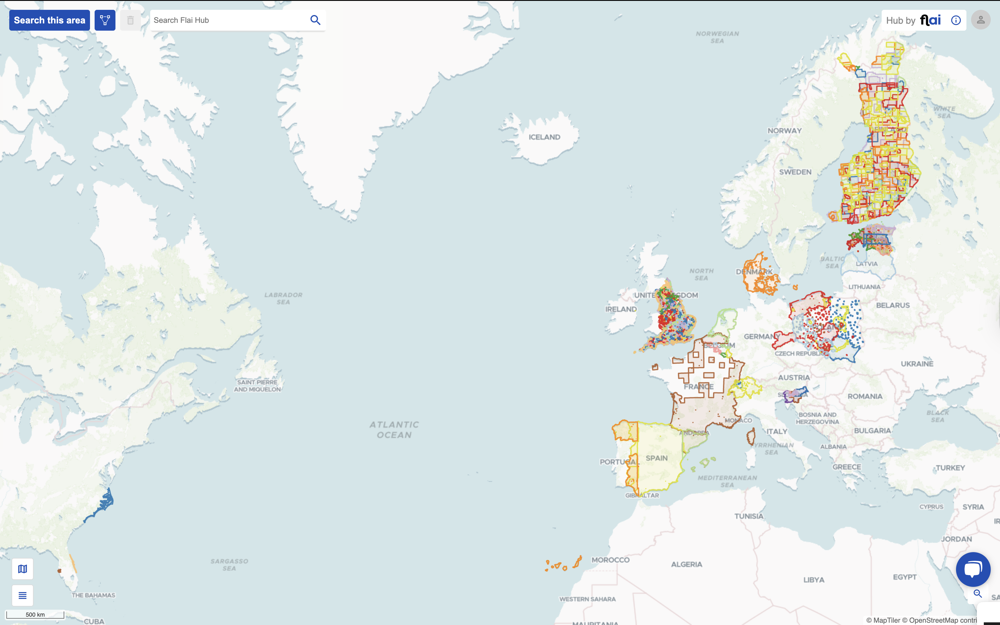

# Open Lidar Data

## Summary

The Open LiDAR Data repository is a centralized platform designed to aggregate publicly available LiDAR datasets from around the world. The primary objective is to mitigate data fragmentation, which currently hinders efficient access and utilization by researchers, developers, and policy analysts.

## About

LiDAR (Light Detection and Ranging) is an essential technology for applications in archaeology, geography, forestry, and urban planning. While many countries have established national LiDAR scanning programs, these datasets are often siloed across multiple institutions, limiting their accessibility and interoperability.

The Open LiDAR Data repository addresses this issue through the following objectives:

- Dataset Consolidation: Initially focused on Europe and the USA, the repository offers streamlined access to comprehensive national LiDAR datasets.
- Support for Research and Development: By providing an organized and unified data source, the platform facilitates a wide range of analytical and application-oriented use cases in both academic and industrial contexts.
- Scalable Global Expansion: The project plans to extend coverage beyond Europe and the USA to incorporate datasets from additional regions, aiming for comprehensive global availability.

## Data

### Overview

| Dataset Name | EPSG | Path | Start | End | Point Density \(points/m²\) | Licences |
| :--- | :--- | :--- | :--- | :--- | :--- | :--- |
| Belgium | 3812 | data/BE/SPW/LIEGE\_2021-2022/copc | 2021-01-01 | 2022-12-31 | 14.75 | SPW, LIDAR point cloud 2021-2022 \[License\]\(https://creativecommons.org/licenses/by/4.0/deed.fr\) |
| Belgium | 3812 | data/BE/SPW/BRABANT\_2021-2022/copc | 2021-01-01 | 2022-12-31 | 11.35 | SPW, LIDAR point cloud 2021-2022 \[License\]\(https://creativecommons.org/licenses/by/4.0/deed.fr\) |
| Belgium | 3812 | data/BE/SPW/NAMUR\_2021-2022/copc | 2021-01-01 | 2022-12-31 | 14.55 | SPW, LIDAR point cloud 2021-2022 \[License\]\(https://creativecommons.org/licenses/by/4.0/deed.fr\) |
| Belgium | 3812 | data/BE/SPW/HAINAUT\_2021-2022/copc | 2021-01-01 | 2022-12-31 | 11 | SPW, LIDAR point cloud 2021-2022 \[License\]\(https://creativecommons.org/licenses/by/4.0/deed.fr\) |
| Belgium | 3812 | data/BE/SPW/LUXEMBOURG\_2021-2022/copc | 2021-01-01 | 2022-12-31 | 13.49 | SPW, LIDAR point cloud 2021-2022 \[License\]\(https://creativecommons.org/licenses/by/4.0/deed.fr\) |
| Belgium | 31370 | data/BE/EODaS/LiDAR\_DHMV\_II-2013-2015/copc | 2013-06-01 | 2015-12-31 | 30.93 | EODaS Openlidar \[License\]\(https://assets.vlaanderen.be/image/upload/v1679331485/GratisopendatalicentieVlaanderenv12\_bqxu2t.pdf\) |
| Denmark | 25832 | data/DK/SDFI/DHM\_2018-2022/copc | 2018-01-01 | 2022-12-31 | 18.57 | Danish Agency for Data Supply and Infrastructure, Denmark's height model - Point cloud, March 2024 \[License\]\(https://dataforsyningen.dk/asset/PDF/rettigheder\_vilkaar/Vilk%C3%A5r%20for%20brug%20af%20frie%20geografiske%20data.pdf\) |
| Dublin City | 29902 | data/IE/NYU\_EDU/Dublin\_City\_2015/copc | 2015-03-01 | 2015-03-31 | 208.7 | \[License\]\(https://creativecommons.org/licenses/by/4.0/\) |
| Estonia \(madal\) | 3301 | data/EE/Maa\_amet/ALS\_2023\_madal/copc | 2023-01-01 | 2023-12-31 | 30.6 | Estonian Land Board, Elevation data 2017-2020 \[License\]\(https://geoportaal.maaamet.ee/docs/Avaandmed/Licence-of-open-data-of-Estonian-Land-Board.pdf\) |
| Estonia \(madal\) | 3301 | data/EE/Maa\_amet/ALS\_2022\_madal/copc | 2022-01-01 | 2022-12-31 | 29.51 | Estonian Land Board, Elevation data 2017-2020 \[License\]\(https://geoportaal.maaamet.ee/docs/Avaandmed/Licence-of-open-data-of-Estonian-Land-Board.pdf\) |
| Estonia \(madal\) | 3301 | data/EE/Maa\_amet/ALS\_2021\_madal/copc | 2021-01-01 | 2021-12-31 | 30.63 | Estonian Land Board, Elevation data 2017-2020 \[License\]\(https://geoportaal.maaamet.ee/docs/Avaandmed/Licence-of-open-data-of-Estonian-Land-Board.pdf\) |
| Estonia \(madal\) | 3301 | data/EE/Maa\_amet/ALS\_2020\_madal/copc | 2020-01-01 | 2020-12-31 | 28.79 | Estonian Land Board, Elevation data 2017-2020 \[License\]\(https://geoportaal.maaamet.ee/docs/Avaandmed/Licence-of-open-data-of-Estonian-Land-Board.pdf\) |
| Estonia \(madal\) | 3301 | data/EE/Maa\_amet/ALS\_2019\_madal/copc | 2019-01-01 | 2019-12-31 | 28.12 | Estonian Land Board, Elevation data 2017-2020 \[License\]\(https://geoportaal.maaamet.ee/docs/Avaandmed/Licence-of-open-data-of-Estonian-Land-Board.pdf\) |
| Estonia \(madal\) | 3301 | data/EE/Maa\_amet/ALS\_2018\_madal/copc | 2018-01-01 | 2018-12-31 | 26.48 | Estonian Land Board, Elevation data 2017-2020 \[License\]\(https://geoportaal.maaamet.ee/docs/Avaandmed/Licence-of-open-data-of-Estonian-Land-Board.pdf\) |
| Estonia \(madal\) | 3301 | data/EE/Maa\_amet/ALS\_2017\_madal/copc | 2017-01-01 | 2017-12-31 | 16.14 | Estonian Land Board, Elevation data 2017-2020 \[License\]\(https://geoportaal.maaamet.ee/docs/Avaandmed/Licence-of-open-data-of-Estonian-Land-Board.pdf\) |
| Estonia \(madal\) | 3301 | data/EE/Maa\_amet/ALS\_2016\_madal/copc | 2016-01-01 | 2016-12-31 | 0.97 | Estonian Land Board, Elevation data 2017-2020 \[License\]\(https://geoportaal.maaamet.ee/docs/Avaandmed/Licence-of-open-data-of-Estonian-Land-Board.pdf\) |
| Estonia \(madal\) | 3301 | data/EE/Maa\_amet/ALS\_2015\_madal/copc | 2015-01-01 | 2015-12-31 | 2.64 | Estonian Land Board, Elevation data 2017-2020 \[License\]\(https://geoportaal.maaamet.ee/docs/Avaandmed/Licence-of-open-data-of-Estonian-Land-Board.pdf\) |
| Estonia \(madal\) | 3301 | data/EE/Maa\_amet/ALS\_2014\_madal/copc | 2014-01-01 | 2014-12-31 | 2.7 | Estonian Land Board, Elevation data 2017-2020 \[License\]\(https://geoportaal.maaamet.ee/docs/Avaandmed/Licence-of-open-data-of-Estonian-Land-Board.pdf\) |
| Estonia \(madal\) | 3301 | data/EE/Maa\_amet/ALS\_2013\_madal/copc | 2013-01-01 | 2013-12-31 | 2.76 | Estonian Land Board, Elevation data 2017-2020 \[License\]\(https://geoportaal.maaamet.ee/docs/Avaandmed/Licence-of-open-data-of-Estonian-Land-Board.pdf\) |
| Estonia \(madal\) | 3301 | data/EE/Maa\_amet/ALS\_2012\_madal/copc | 2012-01-01 | 2012-12-31 | 2.4 | Estonian Land Board, Elevation data 2017-2020 \[License\]\(https://geoportaal.maaamet.ee/docs/Avaandmed/Licence-of-open-data-of-Estonian-Land-Board.pdf\) |
| Estonia \(madal\) | 3301 | data/EE/Maa\_amet/ALS\_2010\_madal/copc | 2010-01-01 | 2010-12-31 | 1.57 | Estonian Land Board, Elevation data 2017-2020 \[License\]\(https://geoportaal.maaamet.ee/docs/Avaandmed/Licence-of-open-data-of-Estonian-Land-Board.pdf\) |
| Estonia \(madal\) | 3301 | data/EE/Maa\_amet/ALS\_2009\_madal/copc | 2009-01-01 | 2009-12-31 | 2.13 | Estonian Land Board, Elevation data 2017-2020 \[License\]\(https://geoportaal.maaamet.ee/docs/Avaandmed/Licence-of-open-data-of-Estonian-Land-Board.pdf\) |
| Estonia \(madal\) | 3301 | data/EE/Maa\_amet/ALS\_2008\_madal/copc | 2008-01-01 | 2008-12-31 | 1.5 | Estonian Land Board, Elevation data 2017-2020 \[License\]\(https://geoportaal.maaamet.ee/docs/Avaandmed/Licence-of-open-data-of-Estonian-Land-Board.pdf\) |
| Estonia \(mets\) | 3301 | data/EE/Maa\_amet/ALS\_2023\_mets/copc | 2023-01-01 | 2023-12-31 | 1.35 | Estonian Land Board, Elevation data 2017-2020 \[License\]\(https://geoportaal.maaamet.ee/docs/Avaandmed/Licence-of-open-data-of-Estonian-Land-Board.pdf\) |
| Estonia \(mets\) | 3301 | data/EE/Maa\_amet/ALS\_2022\_mets/copc | 2022-01-01 | 2022-12-31 | 1.38 | Estonian Land Board, Elevation data 2017-2020 \[License\]\(https://geoportaal.maaamet.ee/docs/Avaandmed/Licence-of-open-data-of-Estonian-Land-Board.pdf\) |
| Estonia \(mets\) | 3301 | data/EE/Maa\_amet/ALS\_2021\_mets/copc | 2021-01-01 | 2021-12-31 | 1.35 | Estonian Land Board, Elevation data 2017-2020 \[License\]\(https://geoportaal.maaamet.ee/docs/Avaandmed/Licence-of-open-data-of-Estonian-Land-Board.pdf\) |
| Estonia \(mets\) | 3301 | data/EE/Maa\_amet/ALS\_2020\_mets/copc | 2020-01-01 | 2020-12-31 | 1.51 | Estonian Land Board, Elevation data 2017-2020 \[License\]\(https://geoportaal.maaamet.ee/docs/Avaandmed/Licence-of-open-data-of-Estonian-Land-Board.pdf\) |
| Estonia \(mets\) | 3301 | data/EE/Maa\_amet/ALS\_2019\_mets/copc | 2019-01-01 | 2019-12-31 | 1.31 | Estonian Land Board, Elevation data 2017-2020 \[License\]\(https://geoportaal.maaamet.ee/docs/Avaandmed/Licence-of-open-data-of-Estonian-Land-Board.pdf\) |
| Estonia \(mets\) | 3301 | data/EE/Maa\_amet/ALS\_2018\_mets/copc | 2018-01-01 | 2018-12-31 | 1.07 | Estonian Land Board, Elevation data 2017-2020 \[License\]\(https://geoportaal.maaamet.ee/docs/Avaandmed/Licence-of-open-data-of-Estonian-Land-Board.pdf\) |
| Estonia \(mets\) | 3301 | data/EE/Maa\_amet/ALS\_2017\_mets/copc | 2017-01-01 | 2017-12-31 | 1 | Estonian Land Board, Elevation data 2017-2020 \[License\]\(https://geoportaal.maaamet.ee/docs/Avaandmed/Licence-of-open-data-of-Estonian-Land-Board.pdf\) |
| Estonia \(mets\) | 3301 | data/EE/Maa\_amet/ALS\_2016\_mets/copc | 2016-01-01 | 2016-12-31 | 0.22 | Estonian Land Board, Elevation data 2017-2020 \[License\]\(https://geoportaal.maaamet.ee/docs/Avaandmed/Licence-of-open-data-of-Estonian-Land-Board.pdf\) |
| Estonia \(mets\) | 3301 | data/EE/Maa\_amet/ALS\_2015\_mets/copc | 2015-01-01 | 2015-12-31 | 0.17 | Estonian Land Board, Elevation data 2017-2020 \[License\]\(https://geoportaal.maaamet.ee/docs/Avaandmed/Licence-of-open-data-of-Estonian-Land-Board.pdf\) |
| Estonia \(mets\) | 3301 | data/EE/Maa\_amet/ALS\_2013\_mets/copc | 2013-01-01 | 2013-12-31 | 0.18 | Estonian Land Board, Elevation data 2017-2020 \[License\]\(https://geoportaal.maaamet.ee/docs/Avaandmed/Licence-of-open-data-of-Estonian-Land-Board.pdf\) |
| Estonia \(mets\) | 3301 | data/EE/Maa\_amet/ALS\_2012\_mets/copc | 2012-01-01 | 2012-12-31 | 0.19 | Estonian Land Board, Elevation data 2017-2020 \[License\]\(https://geoportaal.maaamet.ee/docs/Avaandmed/Licence-of-open-data-of-Estonian-Land-Board.pdf\) |
| Estonia \(tava\) | 3301 | data/EE/Maa\_amet/ALS\_2023\_tava/copc | 2023-01-01 | 2023-12-31 | 3.87 | Estonian Land Board, Elevation data 2017-2020 \[License\]\(https://geoportaal.maaamet.ee/docs/Avaandmed/Licence-of-open-data-of-Estonian-Land-Board.pdf\) |
| Estonia \(tava\) | 3301 | data/EE/Maa\_amet/ALS\_2022\_tava/copc | 2022-01-01 | 2022-12-31 | 4.16 | Estonian Land Board, Elevation data 2017-2020 \[License\]\(https://geoportaal.maaamet.ee/docs/Avaandmed/Licence-of-open-data-of-Estonian-Land-Board.pdf\) |
| Estonia \(tava\) | 3301 | data/EE/Maa\_amet/ALS\_2021\_tava/copc | 2021-01-01 | 2021-12-31 | 3.57 | Estonian Land Board, Elevation data 2017-2020 \[License\]\(https://geoportaal.maaamet.ee/docs/Avaandmed/Licence-of-open-data-of-Estonian-Land-Board.pdf\) |
| Estonia \(tava\) | 3301 | data/EE/Maa\_amet/ALS\_2020\_tava/copc | 2020-01-01 | 2020-12-31 | 3.66 | Estonian Land Board, Elevation data 2017-2020 \[License\]\(https://geoportaal.maaamet.ee/docs/Avaandmed/Licence-of-open-data-of-Estonian-Land-Board.pdf\) |
| Estonia \(tava\) | 3301 | data/EE/Maa\_amet/ALS\_2019\_tava/copc | 2019-01-01 | 2019-12-31 | 3.85 | Estonian Land Board, Elevation data 2017-2020 \[License\]\(https://geoportaal.maaamet.ee/docs/Avaandmed/Licence-of-open-data-of-Estonian-Land-Board.pdf\) |
| Estonia \(tava\) | 3301 | data/EE/Maa\_amet/ALS\_2018\_tava/copc | 2018-01-01 | 2018-12-31 | 2.91 | Estonian Land Board, Elevation data 2017-2020 \[License\]\(https://geoportaal.maaamet.ee/docs/Avaandmed/Licence-of-open-data-of-Estonian-Land-Board.pdf\) |
| Estonia \(tava\) | 3301 | data/EE/Maa\_amet/ALS\_2017\_tava/copc | 2017-01-01 | 2017-12-31 | 2.37 | Estonian Land Board, Elevation data 2017-2020 \[License\]\(https://geoportaal.maaamet.ee/docs/Avaandmed/Licence-of-open-data-of-Estonian-Land-Board.pdf\) |
| Estonia \(tava\) | 3301 | data/EE/Maa\_amet/ALS\_2016\_tava/copc | 2016-01-01 | 2016-12-31 | 0.21 | Estonian Land Board, Elevation data 2017-2020 \[License\]\(https://geoportaal.maaamet.ee/docs/Avaandmed/Licence-of-open-data-of-Estonian-Land-Board.pdf\) |
| Estonia \(tava\) | 3301 | data/EE/Maa\_amet/ALS\_2015\_tava/copc | 2015-01-01 | 2015-12-31 | 0.43 | Estonian Land Board, Elevation data 2017-2020 \[License\]\(https://geoportaal.maaamet.ee/docs/Avaandmed/Licence-of-open-data-of-Estonian-Land-Board.pdf\) |
| Estonia \(tava\) | 3301 | data/EE/Maa\_amet/ALS\_2014\_tava/copc | 2014-01-01 | 2014-12-31 | 0.47 | Estonian Land Board, Elevation data 2017-2020 \[License\]\(https://geoportaal.maaamet.ee/docs/Avaandmed/Licence-of-open-data-of-Estonian-Land-Board.pdf\) |
| Estonia \(tava\) | 3301 | data/EE/Maa\_amet/ALS\_2013\_tava/copc | 2013-01-01 | 2013-12-31 | 0.48 | Estonian Land Board, Elevation data 2017-2020 \[License\]\(https://geoportaal.maaamet.ee/docs/Avaandmed/Licence-of-open-data-of-Estonian-Land-Board.pdf\) |
| Estonia \(tava\) | 3301 | data/EE/Maa\_amet/ALS\_2012\_tava/copc | 2012-01-01 | 2012-12-31 | 0.43 | Estonian Land Board, Elevation data 2017-2020 \[License\]\(https://geoportaal.maaamet.ee/docs/Avaandmed/Licence-of-open-data-of-Estonian-Land-Board.pdf\) |
| Estonia \(tava\) | 3301 | data/EE/Maa\_amet/ALS\_2011\_tava/copc | 2011-01-01 | 2011-12-31 | 0.47 | Estonian Land Board, Elevation data 2017-2020 \[License\]\(https://geoportaal.maaamet.ee/docs/Avaandmed/Licence-of-open-data-of-Estonian-Land-Board.pdf\) |
| Estonia \(tava\) | 3301 | data/EE/Maa\_amet/ALS\_2010\_tava/copc | 2010-01-01 | 2010-12-31 | 0.47 | Estonian Land Board, Elevation data 2017-2020 \[License\]\(https://geoportaal.maaamet.ee/docs/Avaandmed/Licence-of-open-data-of-Estonian-Land-Board.pdf\) |
| Estonia \(tava\) | 3301 | data/EE/Maa\_amet/ALS\_2009\_tava/copc | 2009-01-01 | 2009-12-31 | 0.46 | Estonian Land Board, Elevation data 2017-2020 \[License\]\(https://geoportaal.maaamet.ee/docs/Avaandmed/Licence-of-open-data-of-Estonian-Land-Board.pdf\) |
| Estonia \(tava\) | 3301 | data/EE/Maa\_amet/ALS\_2008\_tava/copc | 2008-01-01 | 2008-12-31 | 0.42 | Estonian Land Board, Elevation data 2017-2020 \[License\]\(https://geoportaal.maaamet.ee/docs/Avaandmed/Licence-of-open-data-of-Estonian-Land-Board.pdf\) |
| Finland | 3067 | data/FI/NLS/05p\_year\_2023/copc | 2023-01-01 | 2023-12-31 | 0.78 | \[License\]\(https://creativecommons.org/licenses/by/4.0/\) |
| Finland | 3067 | data/FI/NLS/05p\_year\_2022/copc | 2022-01-01 | 2022-12-31 | 0.72 | \[License\]\(https://creativecommons.org/licenses/by/4.0/\) |
| Finland | 3067 | data/FI/NLS/05p\_year\_2021/copc | 2021-01-01 | 2021-12-31 | 0.7 | \[License\]\(https://creativecommons.org/licenses/by/4.0/\) |
| Finland | 3067 | data/FI/NLS/05p\_year\_2020/copc | 2020-01-01 | 2020-12-31 | 0.8 | \[License\]\(https://creativecommons.org/licenses/by/4.0/\) |
| Finland | 3067 | data/FI/NLS/05p\_year\_2019/copc | 2019-01-01 | 2019-12-31 | 1.18 | \[License\]\(https://creativecommons.org/licenses/by/4.0/\) |
| Finland | 3067 | data/FI/NLS/05p\_year\_2018/copc | 2018-01-01 | 2018-12-31 | 1.42 | \[License\]\(https://creativecommons.org/licenses/by/4.0/\) |
| Finland | 3067 | data/FI/NLS/05p\_year\_2017/copc | 2017-01-01 | 2017-12-31 | 2.2 | \[License\]\(https://creativecommons.org/licenses/by/4.0/\) |
| Finland | 3067 | data/FI/NLS/05p\_year\_2016/copc | 2016-01-01 | 2016-12-31 | 1.83 | \[License\]\(https://creativecommons.org/licenses/by/4.0/\) |
| Finland | 3067 | data/FI/NLS/05p\_year\_2015/copc | 2015-01-01 | 2015-12-31 | 1.54 | \[License\]\(https://creativecommons.org/licenses/by/4.0/\) |
| Finland | 3067 | data/FI/NLS/05p\_year\_2014/copc | 2014-01-01 | 2014-12-31 | 1.48 | \[License\]\(https://creativecommons.org/licenses/by/4.0/\) |
| Finland | 3067 | data/FI/NLS/05p\_year\_2013/copc | 2013-01-01 | 2013-12-31 | 1.04 | \[License\]\(https://creativecommons.org/licenses/by/4.0/\) |
| Finland | 3067 | data/FI/NLS/05p\_year\_2012/copc | 2012-01-01 | 2012-12-31 | 1.24 | \[License\]\(https://creativecommons.org/licenses/by/4.0/\) |
| Finland | 3067 | data/FI/NLS/05p\_year\_2011/copc | 2011-01-01 | 2011-12-31 | 1.12 | \[License\]\(https://creativecommons.org/licenses/by/4.0/\) |
| Finland | 3067 | data/FI/NLS/05p\_year\_2010/copc | 2010-01-01 | 2010-12-31 | 1.17 | \[License\]\(https://creativecommons.org/licenses/by/4.0/\) |
| Finland | 3067 | data/FI/NLS/05p\_year\_2009/copc | 2009-01-01 | 2009-12-31 | 1.07 | \[License\]\(https://creativecommons.org/licenses/by/4.0/\) |
| Finland | 3067 | data/FI/NLS/05p\_year\_2008/copc | 2008-01-01 | 2008-12-31 | 0.92 | \[License\]\(https://creativecommons.org/licenses/by/4.0/\) |
| France | 2154 | data/FR/IGN/Lidar\_2021/copc | 2021-01-01 | 2025-01-01 | 29.9 | IGN, \[License\]\(https://geoservices.ign.fr/cgu-licences\) |
| Germany | 25833 | data/DE/GeoSN/lidar\_2015-2023/copc | 2015-01-01 | 2023-12-31 | 13.25 | GeoSN, \[dl-de/by-2-0\]\(https://www.govdata.de/dl-de/by-2-0\) |
| Latvia | 3059 | data/LV/LGIA/Lidar\_2013-2019/copc | 2013-01-11 | 2019-12-31 | 8.24 | The Latvian Geospatial Information Agency \[License\]\(https://www.lgia.gov.lv/sites/lgia/files/document/Atverto%20datu%20licence%20CC%20BY\_0.pdf\) |
| Luxembourg | 2169 | data/LU/Gouvernement\_LUX/Lidar\_2019/copc | 2019-01-01 | 2019-12-31 | 29.98 | \[License\]\(https://creativecommons.org/publicdomain/zero/1.0/\) |
| Netherlands | 28992 | data/NL/AHN/AHN4\_2020-2022/copc | 2020-01-01 | 2022-12-31 | 23.36 | The government has shared the AHN publicly in the form of open data in full and without any conditions |
| Poland | 2180 | data/PL/GUGiK/Skaning\_laserowy\_2023/copc | 2023-01-01 | 2023-12-31 | 21.3 | The user can download any required data, without any limitations. |
| Poland | 2180 | data/PL/GUGiK/Skaning\_laserowy\_2022/copc | 2022-01-01 | 2022-12-31 | 18.51 | The user can download any required data, without any limitations. |
| Poland | 2180 | data/PL/GUGiK/Skaning\_laserowy\_2021/copc | 2021-01-01 | 2021-12-31 | 19.77 | The user can download any required data, without any limitations. |
| Poland | 2180 | data/PL/GUGiK/Skaning\_laserowy\_2020/copc | 2020-01-01 | 2020-12-31 | 37.97 | The user can download any required data, without any limitations. |
| Poland | 2180 | data/PL/GUGiK/Skaning\_laserowy\_2019/copc | 2019-01-01 | 2019-12-31 | 17.45 | The user can download any required data, without any limitations. |
| Poland | 2177 | data/PL/GUGiK/Skaning\_laserowy\_2018/copc | 2018-01-01 | 2018-12-31 | 36.54 | The user can download any required data, without any limitations. |
| Slovenia | 3794 | data/SI/GURS/CLSS\_2024/copc | 2024-01-01 | 2024-12-12 | 33.66 | GURS, CLSS 2024 \[License\]\(https://creativecommons.org/licenses/by/4.0/deed.sl\) |
| Slovenia | 3794 | data/SI/GURS/CLSS\_2023/copc | 2023-01-01 | 2023-12-31 | 29.87 | GURS, CLS 2023 \[License\]\(https://creativecommons.org/licenses/by/4.0/deed.sl\) |
| Slovenia | 3794 | data/SI/GURS/LSS\_2011-2015/copc | 2011-01-01 | 2015-12-31 | 20.22 | Slovenian Environment Agency, LIDAR data 2011 - 2015 \[License\]\(https://creativecommons.org/licenses/by/4.0/deed.sl\) |
| Slovenia - extension | 3794 | data/SI/GURS/CLSS\_2023\_extension/copc | 2023-01-01 | 2023-12-31 | 54.29 | GURS, CLS 2023 \[License\]\(https://creativecommons.org/licenses/by/4.0/deed.sl\) |
| Slovenia - Water Corridors | 3794 | data/SI/GURS/Water\_Corridors\_2023/copc | 2023-07-01 | 2023-12-31 | 80.03 | GURS, PLS 2023 \[License\]\(https://creativecommons.org/licenses/by/4.0/deed.sl\) |
| Spain | 25831 | data/ES/CNIG/Lidar\_2015-2021\_epsg25831/copc | 2015-01-01 | 2021-12-31 | 1.61 | \[License\]\(https://creativecommons.org/licenses/by/4.0/\) |
| Spain | 25829 | data/ES/CNIG/Lidar\_2015-2021\_epsg25829/copc | 2015-01-01 | 2021-12-31 | 2.8 | \[License\]\(https://creativecommons.org/licenses/by/4.0/\) |
| Spain | 25830 | data/ES/CNIG/Lidar\_2008-2015\_epsg25830/copc | 2008-01-01 | 2015-01-01 | 0.99 | \[License\]\(https://creativecommons.org/licenses/by/4.0/\) |
| Spain | 25829 | data/ES/CNIG/Lidar\_2008-2015\_epsg25829/copc | 2008-01-01 | 2015-01-01 | 0.9 | \[License\]\(https://creativecommons.org/licenses/by/4.0/\) |
| Spain | 25831 | data/ES/CNIG/Lidar\_2008-2015\_epsg25831/copc | 2008-01-01 | 2015-01-01 | 1.14 | \[License\]\(https://creativecommons.org/licenses/by/4.0/\) |
| Spain - Canary Islands | 4083 | data/ES/CNIG/Lidar\_2022-2025\_epsg4083/copc | 2022-01-01 | 2025-01-01 | 8.6 | \[License\]\(https://creativecommons.org/licenses/by/4.0/\) |
| Spain - Canary Islands | 4083 | data/ES/CNIG/Lidar\_2015-2021\_epsg4083/copc | 2015-01-01 | 2021-12-31 | 1.74 | \[License\]\(https://creativecommons.org/licenses/by/4.0/\) |
| Spain - Canary Islands | 4083 | data/ES/CNIG/Lidar\_2008-2015\_epsg4083/copc | 2008-01-01 | 2015-01-01 | 1.5 | \[License\]\(https://creativecommons.org/licenses/by/4.0/\) |
| Switzerland | 2056 | data/CH/Swiss\_federal\_authorities/swisssurface3d\_2023/copc | 2023-01-01 | 2023-12-31 | 14.98 | Federal Office of Topography swisstopo \[License\]\(https://www.swisstopo.admin.ch/en/terms-of-use-free-geodata-and-geoservices\) |
| Switzerland | 2056 | data/CH/Swiss\_federal\_authorities/swisssurface3d\_2022/copc | 2017-01-01 | 2022-12-31 | 19.56 | Federal Office of Topography swisstopo \[License\]\(https://www.swisstopo.admin.ch/en/terms-of-use-free-geodata-and-geoservices\) |
| United Kingdom | 27700 | data/UK/DEFRA/LIDAR\_2022/copc | 2022-01-01 | 2022-12-31 | 3.45 | © Environment Agency \[License\]\(https://www.nationalarchives.gov.uk/doc/open-government-licence/version/3/\) |
| United Kingdom | 27700 | data/UK/DEFRA/LIDAR\_2021/copc | 2021-01-01 | 2021-12-31 | 2.22 | © Environment Agency \[License\]\(https://www.nationalarchives.gov.uk/doc/open-government-licence/version/3/\) |
| United Kingdom | 27700 | data/UK/DEFRA/LIDAR\_2020/copc | 2020-01-01 | 2020-12-31 | 2.25 | © Environment Agency \[License\]\(https://www.nationalarchives.gov.uk/doc/open-government-licence/version/3/\) |
| United Kingdom | 27700 | data/UK/DEFRA/LIDAR\_2019/copc | 2019-01-01 | 2019-12-31 | 2.83 | © Environment Agency \[License\]\(https://www.nationalarchives.gov.uk/doc/open-government-licence/version/3/\) |
| United Kingdom | 27700 | data/UK/DEFRA/LIDAR\_2018/copc | 2018-01-01 | 2018-12-31 | 2.69 | © Environment Agency \[License\]\(https://www.nationalarchives.gov.uk/doc/open-government-licence/version/3/\) |
| United Kingdom | 27700 | data/UK/DEFRA/LIDAR\_2017/copc | 2017-01-01 | 2017-12-31 | 3.28 | © Environment Agency \[License\]\(https://www.nationalarchives.gov.uk/doc/open-government-licence/version/3/\) |
| United Kingdom | 27700 | data/UK/DEFRA/LIDAR\_2016/copc | 2016-01-01 | 2016-12-31 | 4.38 | © Environment Agency \[License\]\(https://www.nationalarchives.gov.uk/doc/open-government-licence/version/3/\) |
| United Kingdom | 27700 | data/UK/DEFRA/LIDAR\_2015/copc | 2015-01-01 | 2015-12-31 | 3.15 | © Environment Agency \[License\]\(https://www.nationalarchives.gov.uk/doc/open-government-licence/version/3/\) |
| United Kingdom | 27700 | data/UK/DEFRA/LIDAR\_2014/copc | 2014-01-01 | 2014-01-30 | 1.91 | © Environment Agency \[License\]\(https://www.nationalarchives.gov.uk/doc/open-government-licence/version/3/\) |
| United Kingdom | 27700 | data/UK/DEFRA/LIDAR\_2013/copc | 2013-01-01 | 2013-12-31 | 1.58 | © Environment Agency \[License\]\(https://www.nationalarchives.gov.uk/doc/open-government-licence/version/3/\) |
| United Kingdom | 27700 | data/UK/DEFRA/LIDAR\_2012/copc | 2012-01-01 | 2012-12-31 | 2.01 | © Environment Agency \[License\]\(https://www.nationalarchives.gov.uk/doc/open-government-licence/version/3/\) |
| United Kingdom | 27700 | data/UK/DEFRA/LIDAR\_2011/copc | 2011-01-01 | 2011-12-31 | 1.65 | © Environment Agency \[License\]\(https://www.nationalarchives.gov.uk/doc/open-government-licence/version/3/\) |
| United Kingdom | 27700 | data/UK/DEFRA/LIDAR\_2010/copc | 2010-01-01 | 2010-12-31 | 2.33 | © Environment Agency \[License\]\(https://www.nationalarchives.gov.uk/doc/open-government-licence/version/3/\) |
| United Kingdom | 27700 | data/UK/DEFRA/LIDAR\_2009/copc | 2009-01-01 | 2009-12-31 | 1.69 | © Environment Agency \[License\]\(https://www.nationalarchives.gov.uk/doc/open-government-licence/version/3/\) |
| United Kingdom | 27700 | data/UK/DEFRA/LIDAR\_2008/copc | 2008-01-01 | 2008-12-31 | 1.72 | © Environment Agency \[License\]\(https://www.nationalarchives.gov.uk/doc/open-government-licence/version/3/\) |
| United Kingdom | 27700 | data/UK/DEFRA/LIDAR\_2007/copc | 2007-01-01 | 2007-12-31 | 1.22 | © Environment Agency \[License\]\(https://www.nationalarchives.gov.uk/doc/open-government-licence/version/3/\) |
| United Kingdom | 27700 | data/UK/DEFRA/LIDAR\_2006/copc | 2006-01-01 | 2006-12-31 | 1.35 | © Environment Agency \[License\]\(https://www.nationalarchives.gov.uk/doc/open-government-licence/version/3/\) |
| United Kingdom | 27700 | data/UK/DEFRA/LIDAR\_2005/copc | 2005-01-01 | 2005-12-31 | 0.85 | © Environment Agency \[License\]\(https://www.nationalarchives.gov.uk/doc/open-government-licence/version/3/\) |
| USA Topobathy | 32617 | data/US/NOAA/NGS\_Topobathy\_Lidar\_2021/copc | 2021-02-24 | 2021-06-01 | 16.9 | NOAA, \[License\]\(https://nauticalcharts.noaa.gov/data/data-licensing.html?utm\_source=chatgpt.com\) |
| USA Topobathy | 32617 | data/US/NOAA/NGS\_Topobathy\_Lidar\_2021\_South\_Tampa\_Bay/copc | 2021-01-26 | 2021-02-27 | 16.14 | NOAA, \[License\]\(https://nauticalcharts.noaa.gov/data/data-licensing.html?utm\_source=chatgpt.com\) |
| USA Topobathy | 32618 | data/US/NOAA/NGS\_Topobathy\_Coastal\_VA\_NC\_SC/copc | 2019-01-01 | 2020-12-31 | 42.83 | NOAA, \[License\]\(https://nauticalcharts.noaa.gov/data/data-licensing.html?utm\_source=chatgpt.com\) |

For an easier overview, you can explore datasets via [FlaiHub](https://hup.flai.ai) 

In each path, there are the following folders with data:

* `.../copc`
* `.../overview`
* `.../shp`

### Data Formats

All datasets are stored in original data format (LAS or LAZ) and in [COPC](https://copc.io/).  

### Access

#### Download via the Flai Hub

Download the link to the file.

#### Download Via S3

You can download files with [AWS CLI](https://aws.amazon.com/cli/).

Example:

    aws s3 cp s3://open-lidar-data/data/BE/EODaS/LiDAR_DHMV_II-2013-2015/copc/LiDAR_DHMV_2_P1_ATL12104_ES_52500_217000.copc.laz

_To find the name of the file take a look at the main path in __Overview__ and tiling schema, or go to [FlaiHub](hup.flai.ai).

#### Download Via URL

You can download files directly from the URL.

Example:

    https://open-lidar-data.s3.eu-central-1.amazonaws.com/data/BE/EODaS/LiDAR_DHMV_II-2013-2015/copc/LiDAR_DHMV_2_P1_ATL12104_ES_52500_217000.copc.laz

_To find the name of the file take a look at the main path in __Overview__ and tiling schema, or go to [FlaiHub](hup.flai.ai).

## Tutorials

* [How to download data with FlaiHub](tutorials%2Fhow-to-download-data-with-flai-hub.md)

## Contributing

We welcome contributions from the community, whether it's adding new datasets, improving data accessibility, or
providing feedback on how we can better serve users' needs. If you have LiDAR data you'd like to contribute or
suggestions for our project, please see our contribution guidelines or contact us directly.
